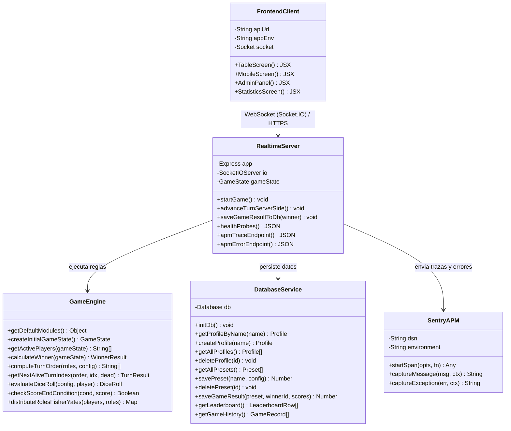

# Arquitectura, Componentes y Stack Tecnológico

## 1. Componentes y Métodos del Sistema

| Componente | Responsabilidad | Métodos principales |
|---|---|---|
| **GameEngine (`src/gameEngine.js`)** | Reglas puras del juego y validaciones | `createInitialGameState()`, `getActivePlayers()`, `calculateWinner()`, `computeTurnOrder()`, `getNextAliveTurnIndex()`, `evaluateDiceRoll()`, `checkScoreEndCondition()`, `distributeRolesFisherYates()` |
| **DatabaseService (`src/database.js`)** | Persistencia en SQLite de perfiles, presets e historial | `initDb()`, `getProfileByName()`, `createProfile()`, `getAllProfiles()`, `deleteProfile()`, `getAllPresets()`, `savePreset()`, `deletePreset()`, `saveGameResult()`, `getLeaderboard()`, `getGameHistory()` |
| **RealtimeServer (`src/app.js`)** | API REST, Health Probes, eventos Socket.IO y endpoints APM | `GET /health`, `GET /ready`, `GET /live`, `GET /api/presets`, `POST /api/dice/roll`, `GET /api/apm/trace`, `POST /api/apm/message`, `GET /api/apm/error`, eventos `joinRole`, `startGame`, `rollDice`, `endTurn`, `updateScore`, `startVote`, `distributeHiddenRoles` |
| **Observability (`src/instrument.js`)** | Instrumentación APM con Sentry | `Sentry.init()`, `startSpan()`, `captureMessage()`, `captureException()`, `setupExpressErrorHandler()` |
| **Frontend SPA (`TableScreen` / `MobileScreen`)** | Vista de TV central con QR dinámico y controladores móviles | `SocketProvider`, `TableScreen`, `MobileScreen`, `AdminPanel`, `StatisticsScreen`, `DiceShape` |

## 2. Diagrama de Clases

## 3. Stack Tecnológico

| Capa | Tecnología | Uso en el proyecto |
|---|---|---|
| **Frontend** | React 18, Vite 5, TailwindCSS, Nginx | Interfaz de TV y móvil con inyección de variables en arranque (`env-config.js`) |
| **Backend** | Node.js 20, Express 4, Socket.IO 4 | API REST, Health Probes y sincronización en tiempo real por WebSockets |
| **Base de Datos** | SQLite (`better-sqlite3`) | Perfiles, presets de juegos e historial de partidas embebido sin dependencias externas |
| **Pruebas y Cobertura** | Vitest + `@vitest/coverage-v8` + Supertest | Pruebas unitarias de lógica, BD, API y WebSockets con reporte de cobertura en CI |
| **Contenedores** | Docker (multi-stage) + Docker Hub (`andreshu07`) | Imágenes inmutables `smarttable-api` y `smarttable-web` etiquetadas por commit SHA |
| **CI / CD** | GitHub Actions + Environments | Pipelines independientes para Backend y Frontend con despliegue a Dev y aprobación manual para Prod |
| **Infraestructura (IaC)** | Terraform (`azurerm ~> 4.0`) | Módulo reutilizable que crea Resource Group, App Service Plans Linux `B1` y Web Apps Dev/Prod |
| **Cloud & Métricas** | Microsoft Azure (App Service for Containers) | Hosting HTTPS con WebSockets y métricas nativas de CPU, Memoria y Requests |
| **APM** | Sentry (`@sentry/node`) | Trazas distribuidas (`tracesSampleRate: 1.0`), captura de errores y logs/mensajes |
