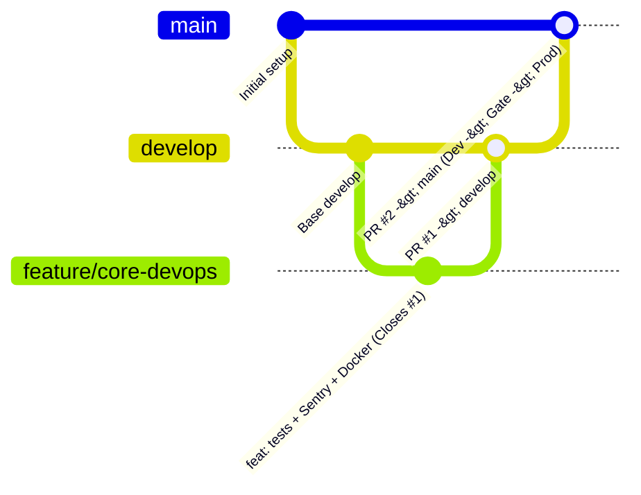

# Estrategia de Ramas y Plan de Trabajo

## 1. Estrategia de Ramas (GitFlow)

Todos los repositorios (`smart-table-os-backend`, `smart-table-os-frontend`, `smart-table-os-infra`) siguen la misma estructura:

- **`main`**: Rama de producción. Solo recibe código validado mediante **Pull Request** desde `develop` o `feature/*`. Al fusionar a `main`, corre CI -> Docker Hub -> Deploy Dev -> **Aprobación manual** -> Deploy Prod.
- **`develop`**: Rama de integración continua. Despliega automáticamente al ambiente **Dev** para validación temprana.
- **`feature/<tarea>`**: Ramas cortas por cada Issue del backlog (por ejemplo `feature/apm-sentry-tests`, `feature/runtime-env-badge`, `feature/terraform-azure-envs`).

## 2. Plan de Trabajo (Issues vinculados a Commits y PRs)

Cada tarea del backlog se registra como Issue en GitHub y se vincula explícitamente en el mensaje del commit y en la descripción del PR (`Refs #N` / `Closes #N`):

| Repo | Issue | Descripción |
|---|---|---|
| `smart-table-os-backend` | `#1` | Refactorizar motor de juego, agregar pruebas unitarias y cobertura con Vitest |
| `smart-table-os-backend` | `#2` | Integrar monitoreo APM con Sentry (trazas, errores, mensajes) y health probes |
| `smart-table-os-backend` | `#3` | Configurar Dockerfile multi-stage y pipeline CI/CD (Docker Hub + Azure Dev/Prod) |
| `smart-table-os-frontend` | `#1` | Soporte de variables en tiempo de ejecución (`env-config.js`) y QR público |
| `smart-table-os-frontend` | `#2` | Configurar Dockerfile Nginx y pipeline CI/CD (Docker Hub + Azure Dev/Prod) |
| `smart-table-os-infra` | `#1` | Aprovisionar Resource Group, App Service Plans B1 y Web Apps Dev/Prod con Terraform |
