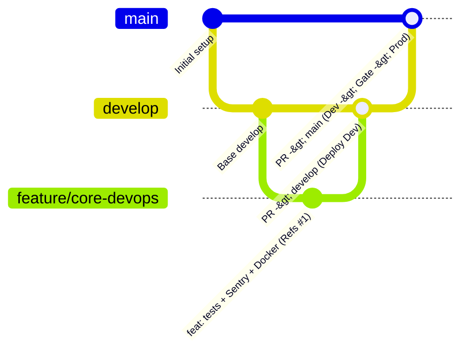

# Estrategia de Ramas y Plan de Trabajo

## 1. Estrategia de Ramas (GitFlow)

Todos los repositorios (`smart-table-os-backend`, `smart-table-os-frontend`, `smart-table-os-infra`) siguen la misma estructura:

- **`main`**: Rama de producción. Solo recibe código validado mediante **Pull Request** desde `develop` o `feature/*`. Al fusionar a `main`, corre CI → Docker Hub → Deploy Dev → **Aprobación manual** → Deploy Prod.
- **`develop`**: Rama de integración continua. Despliega automáticamente únicamente al ambiente **Dev** (sin tocar Producción).
- **`feature/<tarea>`**: Ramas cortas por cada Issue del backlog (por ejemplo `feature/increase-test-coverage`, `feature/docker-compose-local`, `feature/dockerhub-overview-sync`).

## 2. Tablero Kanban (GitHub Projects)

El seguimiento unificado de todos los PBIs de los 4 repositorios se gestiona en el tablero público:

- **GitHub Project Board:** https://github.com/users/AndresHv007/projects/1

## 3. Plan de Trabajo (Issues vinculados a Commits y PRs)

Cada tarea del backlog se registra como Issue (`PBI`, `DevOps`, Milestone *Sprint Final — Entrega DevOps*) y se vincula explícitamente en commits y PRs (`Refs #N` / `Closes #N`):

| Repo | Issue | Descripción | Estado |
|---|---|---|---|
| `smart-table-os` | `#1` | Documentar arquitectura, diagramas, infra y plan de trabajo en Wiki | Done (PR #2) |
| `smart-table-os` | `#3` | Tablero Kanban en GitHub Projects, Sidebar en Wiki y Overview automático Docker Hub | In Progress |
| `smart-table-os-backend` | `#1` | Modularizar motor de juego y agregar pruebas unitarias con cobertura (Vitest) | Done (PR #5) |
| `smart-table-os-backend` | `#2` | Integrar monitoreo APM con Sentry (trazas, errores, mensajes) y health probes | Done (PR #5) |
| `smart-table-os-backend` | `#3` | Contenerización Docker Hub y Pipeline CI/CD Azure Dev/Prod con gate manual | Done (PR #5) |
| `smart-table-os-backend` | `#6` | Ampliar pruebas de integración para superar 85% de cobertura (**91.29% logrado**) | Done (PR #8) |
| `smart-table-os-frontend` | `#1` | Inyección de variables en runtime (`env-config.js`), badge `DEV/PROD` y QR público | Done (PR #4) |
| `smart-table-os-frontend` | `#2` | Dockerfile Nginx SPA y Pipeline CI/CD Azure Dev/Prod con gate manual | Done (PR #4) |
| `smart-table-os-frontend` | `#5` | Mejora visual en `TableScreen` para demo en vivo Dev → Prod | Todo |
| `smart-table-os-infra` | `#1` | Infraestructura como Código en Terraform para Azure App Service Dev y Prod | Done (PR #3) |
| `smart-table-os-infra` | `#5` | Entorno local completo con Docker Compose (`3001`/`5173`) y validación en CI | Done (PR #7) |
