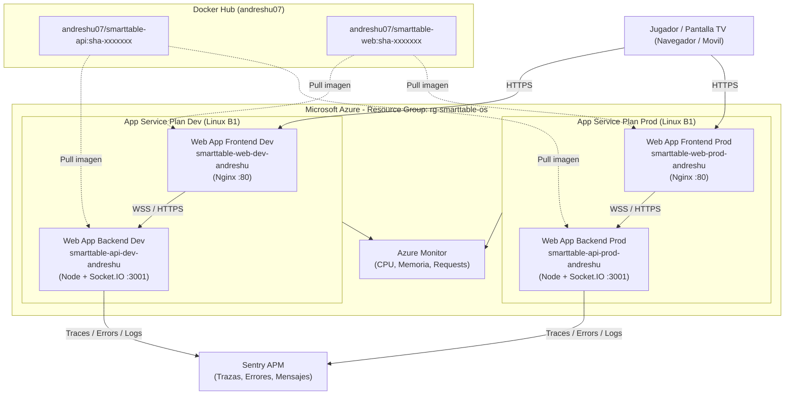
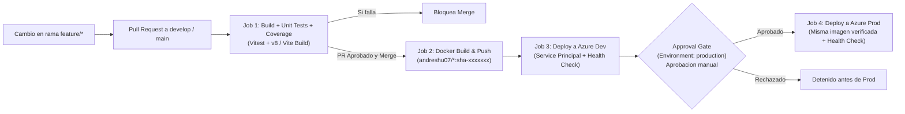

# Infraestructura en Azure y Diagrama de Deployment

## 1. Recursos creados con Terraform (`smart-table-os-infra`)

Todo el aprovisionamiento vive en el repositorio de infraestructura (`smart-table-os-infra`) usando un módulo reutilizable (`modules/environment`) instanciado para **Dev** y **Prod**:

- **Resource Group:** `rg-smarttable-os` (`eastus2`)
- **Ambiente Dev:**
  - App Service Plan Linux `B1`: `asp-smarttable-dev-andreshu`
  - Web App Backend: `https://smarttable-api-dev-andreshu.azurewebsites.net`
  - Web App Frontend: `https://smarttable-web-dev-andreshu.azurewebsites.net`
- **Ambiente Prod:**
  - App Service Plan Linux `B1`: `asp-smarttable-prod-andreshu`
  - Web App Backend: `https://smarttable-api-prod-andreshu.azurewebsites.net`
  - Web App Frontend: `https://smarttable-web-prod-andreshu.azurewebsites.net`

## 2. Diagrama de Infraestructura (Azure + Docker Hub + Sentry)

## 3. Diagrama de Deployment (CI/CD con GitHub Actions)

## 4. Monitoreo y Observabilidad

- **APM (Sentry — `andres-huerta.sentry.io`):**
  - **Trazas:** `GET /api/apm/trace` y `POST /api/dice/roll` registran transacciones y sub-spans (`db.sqlite`, `game.engine`).
  - **Mensajes/Logs:** `GET/POST /api/apm/message` registra mensajes de auditoría con `Sentry.captureMessage`.
  - **Errores:** `GET /api/apm/error` y `POST /api/apm/exception` reportan excepciones reales a Sentry Issues.
- **Métricas de Infraestructura (Azure Portal):**
  - En `asp-smarttable-dev-andreshu` y `asp-smarttable-prod-andreshu` -> **Monitoring -> Metrics**:
    - `CPU Percentage`
    - `Memory Percentage`
    - `Requests` (en cada Web App)
